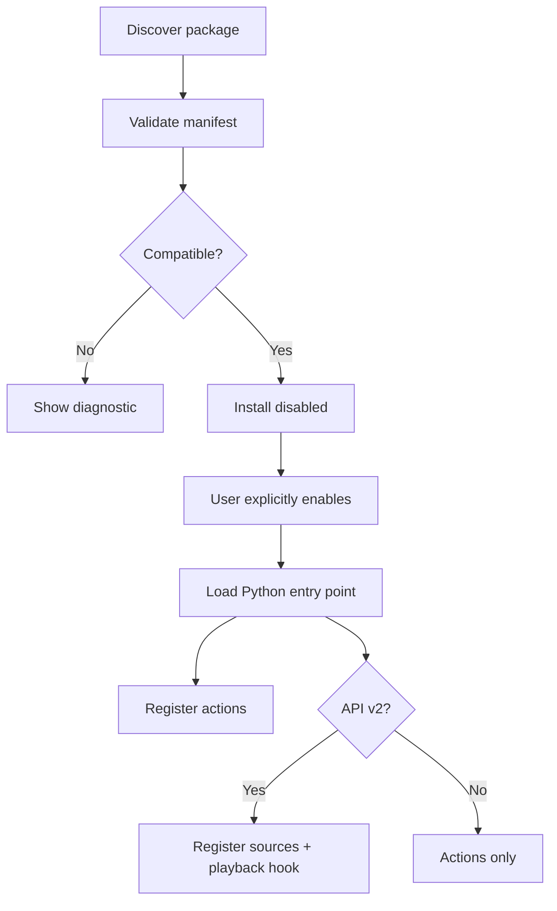

# Add-on SDK 🧩

RintrofliX has two deliberately distinct extension contracts. API v1 remains compatible and action-oriented. API v2 adds channel-source registration and a playback hook.

## API capability matrix

| Capability | API v1 | API v2 |
|---|:---:|:---:|
| Register actions | ✅ | ✅ |
| Show toast notifications | ✅ | ✅ |
| Namespaced settings | ✅ | ✅ |
| Register channel sources | ❌ | ✅ |
| Participate in channel playback hook | ❌ | ✅ |

!!! important "No source injection in v1"
    API v1 is not a source-provider API. An add-on that contributes channels must explicitly declare API v2 and use `register_source`. Do not design a v1 add-on around hidden source injection or an assumed playback callback.

## Package layout

```text
my-addon/
├── addon.json
├── main.py
└── README.md
```

Example manifest:

```json
{
  "id": "example.hello",
  "name": "Hello RintrofliX",
  "version": "1.0.0",
  "api_version": 1,
  "entry": "main.py",
  "description": "A small example action."
}
```

## Lifecycle



## Dependencies and compatibility

Manifests may declare requirements for the RintrofliX version and other add-ons. The manager checks constraints before loading extension code and prevents disabling a dependency while an enabled dependent still requires it.

Supported version operators in the documented baseline include `>=`, `<=`, `==`, `>`, `<` and `~=`.

## Security model ⚠️

- Add-ons are installed disabled and require explicit user action to enable.
- Archive validation rejects path traversal, symlinks/special files, unsupported file types and oversized packages.
- Python code executes with the application's permissions once enabled.
- There is no Python sandbox and archive validation is not malware detection.
- Only install packages from operators you trust.

## Repository index (2.6.0 foundation)

The repository service accepts JSON with `format: 1` and an `addons` array. Entries contain `id`, `version`, `url` and `sha256`, with optional `name` and `description`.

- Index and package URLs must use HTTPS.
- Index and package sizes are bounded.
- Package bytes are checked against the index SHA-256 before installation.
- The service foundation exists; a complete repository-browsing UI is not part of 2.6.0.

!!! danger "Integrity is not authenticity"
    SHA-256 detects bytes that do not match the supplied index. If an attacker can replace both the package and the index, the digest alone does not identify the publisher. Signed metadata and pinned trust keys are future work.
