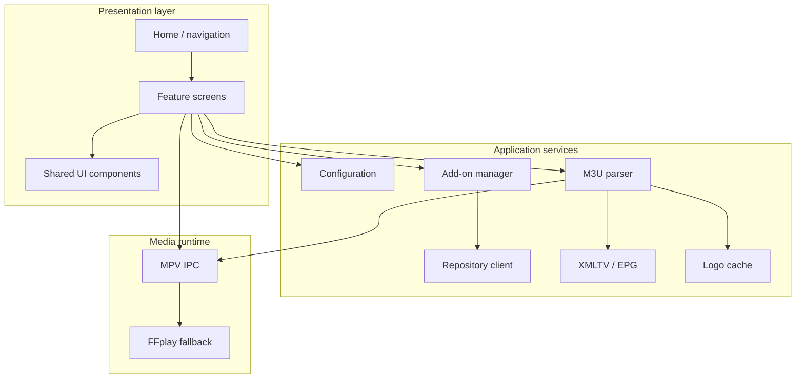
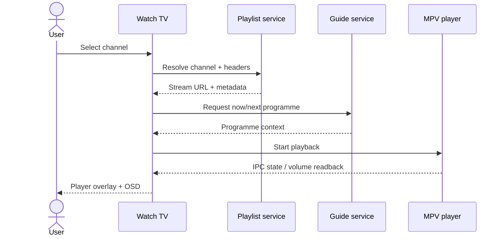

# Architecture 🧠

RintrofliX separates presentation from media services so the UI can evolve without rewriting playlist parsing, EPG handling or playback integration.

## System map

## Module responsibilities

| Module | Responsibility |
|---|---|
| `main.py` | Application lifecycle, navigation and screen workflows |
| `ui.py` | Shared visual primitives and layout helpers |
| `player.py` | MPV process integration, IPC, OSD and playback state |
| `m3u.py` | Playlist parsing and channel metadata |
| `epg.py` | XMLTV parsing, matching and guide data |
| `net.py` | Bounded network downloads and transport helpers |
| `logos.py` | Asynchronous logo retrieval and local cache |
| `addons.py` | Manifest validation, API dispatch, dependency handling |
| `repository.py` | HTTPS index parsing, package digest check and installation handoff |
| `config.py` | Persistent settings and migration defaults |
| `input.py` | Controller input abstraction |
| `fbdisplay.py` | Display/framebuffer handoff support |

## Data flow: live channel

## Design constraints

- Target display class: 640×480.
- Prefer large text, generous row height and visible focus.
- Avoid background scans of entire removable storage.
- Keep network reads bounded and preserve TLS certificate checks.
- Keep playback display ownership with MPV while video is active; the app sends OSD commands through IPC rather than drawing over the decoder.

## Runtime dependencies

| Component | Role | Notes |
|---|---|---|
| Python 3 | Application runtime | Must be available in the selected muOS runtime path |
| Pygame | UI rendering | Required for the graphical frontend |
| MPV | Primary playback | Recommended for the complete in-video menu |
| FFplay | Basic fallback | Does not provide the full MPV OSD experience |

!!! warning "Target-device validation"
    The documented 2.6.0 build environment did not include Pygame or MPV and was not attached to an RG35XX H. Framebuffer handoff, renderer behaviour, controller mapping and MPV OSD still require physical-device validation.
