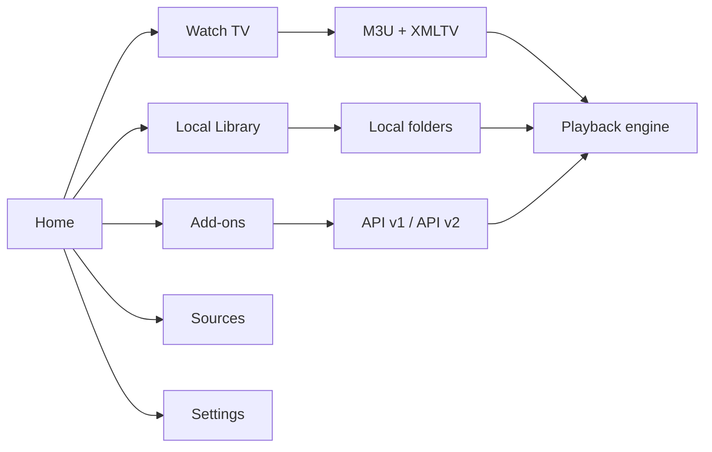

  

    
MUOS · HANDHELD MEDIA CENTRE

    # Your media. Your handheld. Your rules. ✨
    A controller-first, Kodi-inspired media experience designed for the compact screen and buttons of the Anbernic H700 family.

    

      <a class="md-button md-button--primary" href="installation/">Get started →</a>
      <a class="md-button" href="architecture/">Explore the architecture</a>
    

    
🟣 Modular🔵 Controller-first🟠 Open to extensions

  

  

    

    

<i></i><i></i><i></i><b>RINTROFLIX</b>

▶

<i></i><i></i><i></i>

LIVE · LIBRARY · ADD-ONS

    

  

<strong>2.6.0</strong>Documented app baseline

<strong>640×480</strong>Handheld UI target

<strong>2 APIs</strong>Add-on compatibility

<strong>22/22</strong>Baseline unit tests passing*

<small>* Reported by the 2.6.0 working source baseline; the repository's own CI has not yet run the application suite.</small>

## 🎬 One home for the whole experience

RintrofliX brings the essentials together without turning a handheld into a desktop UI squeezed onto a tiny display.

📡<h3>Watch TV</h3>
Browse channels, groups, favourites, search and the electronic programme guide.
<a href="features/#watch-tv">Explore TV →</a>

🎞️<h3>Local Library</h3>
Browse folders on demand and play local video without scanning the entire SD card.
<a href="features/#local-library">Explore library →</a>

🧩<h3>Add-ons</h3>
Extend the app with explicit, versioned APIs and dependency checks.
<a href="addons/">Explore the SDK →</a>

🛠️<h3>Sources & Settings</h3>
Keep playlist and guide configuration separate from general extension management.
<a href="features/#sources-and-settings">Explore settings →</a>

## 🧭 How the experience fits together

## 📊 Product focus

The following chart is a qualitative prioritisation snapshot, not telemetry or measured usage.

<canvas id="focusChart" height="120" aria-label="Qualitative product focus chart"></canvas>

Design priorities: readability, reliable playback, modularity and safe extension management.

## 🚦 Project status

| Area | Status | Notes |
|---|---|---|
| Core media experience | Baseline documented | Current application baseline: 2.6.0 |
| Add-on API v1/v2 | Implemented in baseline | v1 actions; v2 source registration and playback hook |
| Repository index service | Foundation implemented | HTTPS + SHA-256 integrity; no publisher signatures |
| Dynamic repository UI | Planned | Not part of the 2.6.0 baseline |
| Physical device validation | Pending | Requires RG35XX H / muOS testing |

!!! info "A living handbook"
    This site is designed to evolve alongside the application. Features, API contracts, known limitations and release notes should be updated with every meaningful code change.

!!! warning "No bundled TV subscription"
    RintrofliX does not ship a personal playlist URL or a paid content service. Users must configure sources they are authorised to access.
