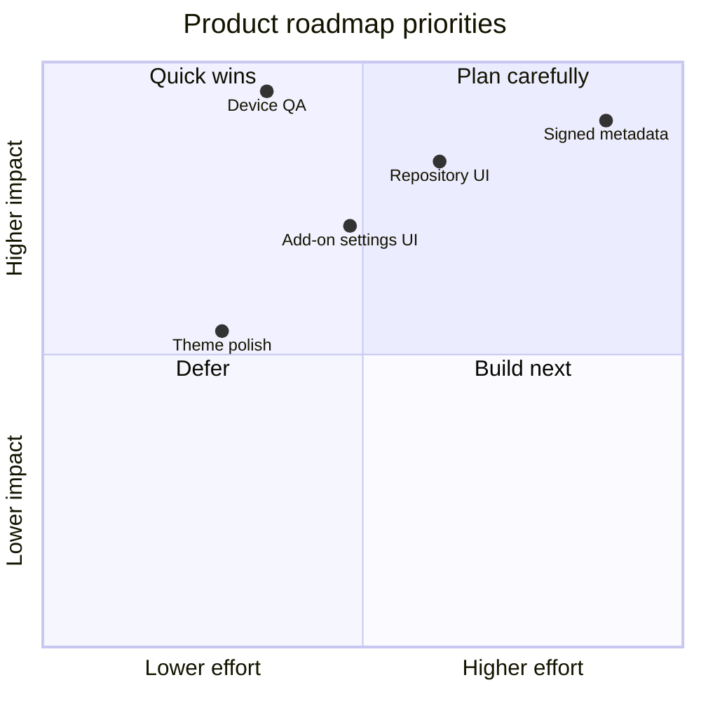

# Roadmap 🚀

The roadmap separates delivered foundations from work that still needs implementation and validation. It is not a promise that every item is already available.

## Release direction

| Milestone | Focus | State |
|---|---|---|
| 2.4.x | API v2 source providers and playback integration | Baseline implemented |
| 2.5.0 | Add-on dependency and compatibility checks | Baseline implemented |
| 2.6.0 | HTTPS repository index and SHA-256 package integrity | Foundation implemented |
| 2.7.x | Repository Manager UI and dynamic add-on settings | Planned |
| 2.8.x | Publisher signatures and trust-key management | Planned / security design required |
| Next | Device QA, release automation and polished onboarding | Ongoing |

## Priority map

## Next engineering goals

### 1. Repository Manager
- Add, refresh and remove HTTPS repositories.
- Browse available add-ons and inspect metadata.
- Show digest verification and install outcomes clearly.
- Keep trust warnings visible.

### 2. Dynamic add-on settings
- Define a validated settings schema in each manifest.
- Render controls based on schema types.
- Validate and persist values through the namespaced add-on settings API.
- Never evaluate arbitrary UI code from an add-on manifest.

### 3. Signed repository metadata
- Define a canonical signed-index format.
- Pin publisher public keys locally and expose trust decisions.
- Fail closed when a signature is required but cannot be verified.
- Do not confuse a valid hash with a trusted publisher identity.

### 4. Device validation
- Verify framebuffer ownership and display restoration.
- Test all controller mappings on target hardware.
- Validate MPV IPC, OSD, audio tracks, subtitles and volume readback.
- Check cold boot, resume and repeated launch/exit cycles.

## Definition of done

A feature is not complete merely because its code compiles. It should have automated tests, clear documentation, failure-state handling and—where hardware is involved—a recorded device test.
