# Security & trust 🔐

RintrofliX handles user-supplied playlist URLs, network responses, downloaded artwork, repository metadata and third-party Python add-ons. These surfaces have different risk profiles.

## Security controls in the 2.6.0 baseline

| Surface | Control | Limitation |
|---|---|---|
| HTTPS requests | Certificate verification remains enabled | Does not make a source trustworthy |
| Network reads | Bounded download sizes | A trusted endpoint can still serve bad content |
| Add-on archives | Path/type/size validation | Not a sandbox or malware scanner |
| Add-on loading | Disabled until explicit enable | Enabled code runs with app permissions |
| Repository packages | SHA-256 compared with index | Does not authenticate the index publisher |

## Trust model

```mermaid
flowchart TD
    A[Repository URL] --> B[HTTPS transport]
    B --> C[Parse bounded index]
    C --> D[Read package URL + SHA-256]
    D --> E[Download bounded package]
    E --> F{Digest matches?}
    F -- No --> G[Reject package]
    F -- Yes --> H[Pass to archive validator]
    H --> I[Install disabled]
    I --> J[User explicitly enables]
    J --> K[Python code runs with app permissions]
```

## Safe-use guidance

!!! danger "Treat add-ons as executable code"
    Only enable add-ons whose source and maintainer you trust. The current package manager does not sandbox Python.

!!! warning "Repository hashes do not authenticate publishers"
    A SHA-256 digest protects against mismatch between an index entry and downloaded package bytes. Publisher signatures and pinned trust keys are not implemented in the 2.6.0 baseline.

- Never put private playlist URLs, credentials or tokens in source control.
- Do not disable TLS verification to work around certificate errors.
- Prefer HTTPS sources and inspect add-on permissions before enabling.
- Report security issues privately to the repository maintainer rather than posting exploitable details publicly.
